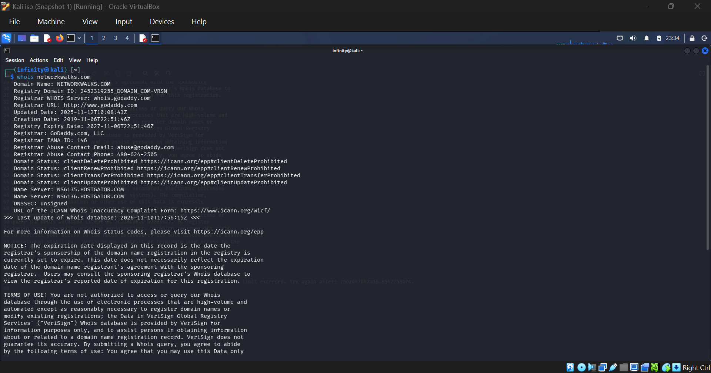
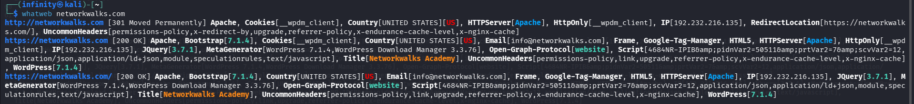
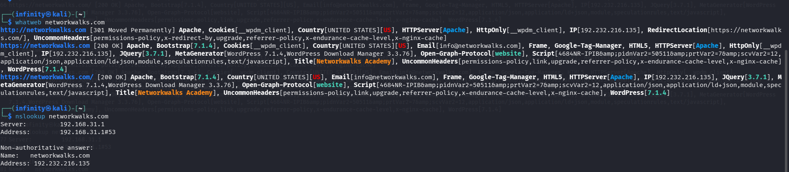
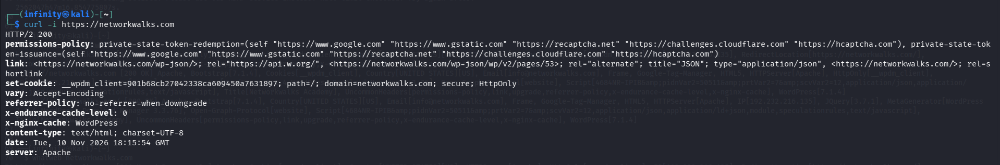
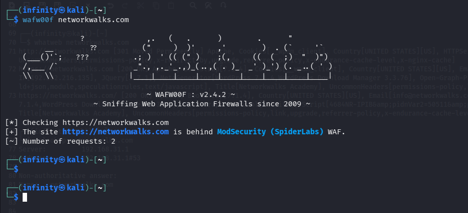
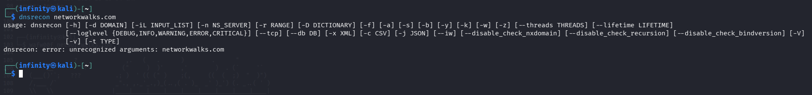

# NETWORKWALKS-B084J-WK2-PM1-FOOTPRINTING-RECON-KALI-TOOLS

Footprinting & Reconnaissance with Multiple Kali Tools

**Building a complete public profile of a target website using six built-in Kali Linux reconnaissance tools**

## Project Overview

This project focuses on **footprinting and passive reconnaissance** of the live website **networkwalks.com** using six built-in Kali Linux tools: `whois`, `whatweb`, `nslookup`, `curl`, `wafw00f` and `dnsrecon`.

Reconnaissance is the first step in any real attack or security test. Before touching a target, an attacker quietly collects as much public information as possible: who owns the domain, its real IP address, the hosting provider, the web technologies it runs, its DNS and mail records, and whether a firewall is protecting it.

Each tool reveals a different piece of the target, and together they build a full profile of it. The findings from this project are the foundation for the scanning and attack-simulation projects that follow.

The work was performed in the Kali Linux virtual machine built in Week 1 (VirtualBox).

## Objectives

The main objectives of this project are to:

- Find domain registration details using `whois`.
- Fingerprint web technologies using `whatweb`.
- Resolve the domain to its IP address using `nslookup`.
- Read HTTP response headers using `curl`.
- Detect a Web Application Firewall using `wafw00f`.
- Enumerate DNS records using `dnsrecon`.
- Save a screenshot and a text-file output for every task.
- Understand how attackers use each piece of information.
- Document the complete process, including mistakes and fixes.
- Prepare the findings for future scanning and security-testing projects.

## Purpose of the Lab

This lab provides an isolated and controlled environment for learning **footprinting and reconnaissance** techniques.

It can be used for activities such as:

- Domain and registrar investigation
- Web technology fingerprinting
- DNS enumeration
- HTTP header analysis
- Firewall (WAF) detection
- Attack-surface mapping

# Lab Setup Procedure

All commands were run from a terminal in Kali Linux. The screenshot and text output of each command were saved for the final report.

## Step 1. Domain Registration Lookup (whois)

`whois` queries the public domain registration record to find who owns the domain, when it was registered, and its name servers.

**Tool:** whois

```
whois networkwalks.com
```



**Key findings:**

- Registrar: GoDaddy.com, LLC (IANA ID 146)
- Creation date: 2019-11-06
- Last updated: 2025-11-12
- Registry expiry date: 2027-11-06
- Name servers: `NS6135.HOSTGATOR.COM`, `NS6136.HOSTGATOR.COM`
- Domain status: client delete, renew, transfer and update prohibited (registrar lock enabled)
- DNSSEC: unsigned
- Registrar abuse contact: abuse@godaddy.com

**How attackers use this:** The name servers point to HostGator, so an attacker instantly learns the hosting provider. Registration dates and abuse contacts help with social engineering and planning.

## Step 2. Web Technology Fingerprinting (whatweb)

`whatweb` identifies the web server, CMS, plugins, frameworks and IP address of the website.

**Tool:** whatweb

```
whatweb networkwalks.com
```



**Key findings:**

- Web server: Apache
- CMS: WordPress 7.1.4
- Plugin: WordPress Download Manager 3.3.76
- Libraries/other: jQuery 3.7.1, Bootstrap, HTML5, Google Tag Manager
- Page title: Networkwalks Academy
- Server IP: 192.232.216.135 (Country: United States)
- Contact email exposed: info@networkwalks.com
- HTTP redirects to HTTPS (301 Moved Permanently)
- Cookie set: `__wpdm_client` (HttpOnly)

**How attackers use this:** whatweb exposes exact software and versions. An attacker looks these up in vulnerability databases to find known exploits. It also leaks the server IP and an email address.

## Step 3. DNS Resolution (nslookup)

`nslookup` resolves the domain name to its IP address using DNS.

**Tool:** nslookup

```
nslookup networkwalks.com
```



**Key finding:** `networkwalks.com` resolves to **192.232.216.135**. The answer is non-authoritative and was returned by the local DNS server `192.168.31.1`.

**How attackers use this:** Knowing the real IP lets an attacker scan the server directly, look up other sites on the same IP, and map the target's infrastructure.

## Step 4. HTTP Response Headers (curl)

`curl -I` reads the HTTP response headers to reveal the server banner, status, cookies and redirects.

**Tool:** curl

```
curl -I https://networkwalks.com
```



**Key findings:**

- Status: `HTTP/2 200`
- Server: Apache
- Cache header: `x-nginx-cache: WordPress`
- Cookie: `__wpdm_client` (path=/; secure; HttpOnly)
- Hidden endpoint: WordPress REST API at `/wp-json/` (exposed in the `link` header)
- `referrer-policy: no-referrer-when-downgrade` and a `permissions-policy` header are present
- Common hardening headers such as `strict-transport-security`, `content-security-policy` and `x-frame-options` do not appear in the captured response
- Response date: Tue, 10 Nov 2026 18:15:54 GMT

**How attackers use this:** HTTP headers leak the web server, caching stack and hidden endpoints. Attackers read headers to fingerprint the stack and find entry points without even loading the full page.

## Step 5. Web Application Firewall Detection (wafw00f)

`wafw00f` detects whether a Web Application Firewall (WAF) is protecting the target site.

**Tool:** wafw00f (v2.4.2)

```
wafw00f networkwalks.com
```



**Key finding:** The site `https://networkwalks.com` is behind a **ModSecurity (SpiderLabs) WAF**. Detection took 2 requests.

**How attackers use this:** Knowing a WAF is present shapes the whole attack: naive attempts will be blocked or logged, so the attacker must adapt or try to bypass it.

## Step 6. DNS Enumeration (dnsrecon)

`dnsrecon` enumerates DNS records: name servers, mail servers, SPF, TXT and service (SRV) records.

**Tool:** dnsrecon

```
dnsrecon -d networkwalks.com
```



**Key findings:**

- SOA record: `ns6135.hostgator.com` (50.87.144.87)
- Name servers (NS): `ns6135.hostgator.com` (50.87.144.87) and `ns6136.hostgator.com` (192.232.216.131)
- DNS software version exposed: Bind `9.16.23-RH` on both name servers
- Mail server (MX): `mail.networkwalks.com` (192.232.216.135)
- A record: `networkwalks.com` resolves to 192.232.216.135
- SPF record: `v=spf1 +a +mx +ip4:50.87.144.87 +include:websitewelcome.com ~all`
- TXT record: Google site verification
- 8 SRV records for `_autodiscover._tcp` pointing to `cpanelemaildiscovery.cpanel.net` on port 443 (cPanel email autodiscovery)
- No answer to the DNSSEC query, which matches the `DNSSEC: unsigned` result from whois

**How attackers use this:** dnsrecon maps the target's entire DNS footprint: mail servers, DNS software version, SPF policy and service records. Each record is a potential foothold and helps an attacker understand the email and hosting setup.

# 🔎 Lab Verification

| ✅ Test                  | 🧾 Command                          | 🎯 Expected Result                       |
| ----------------------- | ---------------------------------- | --------------------------------------- |
| 📋 Domain registration  | `whois networkwalks.com`           | Registrar, dates and name servers shown |
| 🧩 Web technologies     | `whatweb networkwalks.com`         | Apache, WordPress, plugin, IP shown     |
| 🌍 IP resolution        | `nslookup networkwalks.com`        | 192.232.216.135                         |
| 📨 HTTP headers         | `curl -I https://networkwalks.com` | HTTP/2 200 with server headers          |
| 🛡️ Firewall detection   | `wafw00f networkwalks.com`         | ModSecurity (SpiderLabs) detected       |
| 🗂️ DNS enumeration      | `dnsrecon -d networkwalks.com`     | NS, MX, A, TXT and SRV records listed   |

## Summary of Target Profile

```
Domain:            networkwalks.com
Registrar:         GoDaddy.com, LLC
Hosting provider:  HostGator (from name servers)
IP Address:        192.232.216.135
Web Server:        Apache
CMS:               WordPress 7.1.4
Plugin:            WordPress Download Manager 3.3.76
WAF:               ModSecurity (SpiderLabs)
Exposed endpoint:  /wp-json/ (WordPress REST API)
Exposed email:     info@networkwalks.com
```

# What I Learned

Through this project, I learned how to build a complete profile of a target using only public information and built-in Kali Linux tools.

The most important concepts I learned include:

### 1. Passive Reconnaissance

Footprinting only reads information the target has already made public, so the target never knows it is being studied. This is why recon is powerful and very hard to detect.

### 2. Each Tool Reveals a Different Piece

`whois` and DNS tools reveal ownership, IP, hosting and mail servers. `whatweb` and `curl` fingerprint the software and versions. `wafw00f` shows whether a firewall is watching. Together they build the full picture.

### 3. Information Leakage Creates Attack Surface

Exposed software versions, server banners, hidden endpoints such as `/wp-json/` and exposed email addresses all make later attack stages easier.

### 4. Command Syntax Matters

The dnsrecon error showed me that tools expect specific options (`-d` for the domain). Reading the usage message and the `--help` output is the fastest way to fix such errors.

### 5. Defenders Run the Same Tools

Defenders run these same tools on their own systems to see what an attacker would see, and then reduce it (for example by hiding version banners, keeping software updated and limiting exposed information).

### 6. Documentation

I learned that saving screenshots and text outputs for every command is an important part of a professional cybersecurity project, and that these findings will be reused in future scanning projects.

# Security & Ethical Use

This laboratory is intended strictly for education purposes only. Footprinting was performed using public-information tools against the target specified in the course exercise. Never test systems you do not own or do not have written permission to test.

# Author

**ANANT KUMAR SAGAR**  
Cybersecurity Student B084J

LinkedIn: [https://www.linkedin.com/in/anantkumarsagar/](https://www.linkedin.com/in/anantkumarsagar/)

## Project Information

**Program Name:** Cybersecurity at Networkwalks | **Week:** 02 | **Project:** Footprinting & Reconnaissance with Multiple Kali Tools | **Repository:** GitHub
